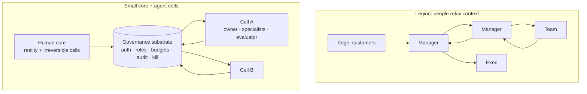

# agent-governance-mcp

An MCP server that lets a company be run by a small human core plus agents, where every agent has scoped authority, a budget, a reviewer that isn't itself, and an off switch.

It's the working code behind an org-design argument. This README makes the argument, then maps each claim to the code that enforces it.

## Old shape: the legion
Most companies are still organized like a Roman legion. Information comes in at the edge, then moves up and down through layers of managers who relay it, summarize it, re-prioritize it and pass it on. The layers exist because people need coordinating: someone has to carry context, assign work, check it and report status.

That made sense when every step needed a person. It's slow, and most of the cost sits in the relay, not the work.

## New shape: a small core and agent cells
When agents can carry context and run bounded loops, the relay layers don't have to exist. What's left:

- **A small human core** that interfaces with reality (customers, markets, trust) and owns the decisions that can't be undone.
- **Agent cells**, each a complete bet on turning one customer problem into revenue. A cell has an owner agent, specialists, a budget and an evaluator.
- **Rules instead of managers.** Authority, budgets, review and shutdown are enforced by the substrate, not by someone checking in.

This only works if the rules are real. "The agent is supposed to ask first" isn't governance. A permission the server refuses to grant is. That's what this repo is.



## Org idea → what the code enforces

| Org idea | How it's enforced here | Where |
|---|---|---|
| Authority comes from identity, not from what an agent claims | Default-deny policy. Grants come only from a verified principal at the auth boundary. A role or company named in a tool payload can never add a grant. | `policy.py`, `auth.py`, `supabase_auth.py` |
| Every agent has a job description | Seven roles (founder, allocator, cell owner, specialist, evaluator, immune, observer), each with a fixed capability set. Agent definitions declare a capability ceiling. | `policy.py`, `models.py`, `agents/` |
| The human core keeps the irreversible calls | Founder-only capabilities: irreversible cell transitions, irreversible budget commits, promoting a learning into the shared rules, managing authorization, amending the constitution, approving irreversible actions | `policy.py` (`FOUNDER_ONLY_CAPABILITIES`) |
| Nobody grades their own work | Separation of duties: execution and evaluation have to come from different principals | `policy.py` (`SeparationOfDutiesError`) |
| A cell spends only what it was given | An allocator proposes and commits bounded allocations into hierarchical ledgers. Work spends against an active reservation, and it fails closed if the cost exceeds what's left. | `service.py`, `ledger_units.py`, `supabase/migrations/*budget*`, `*reservation*` |
| Anything can be stopped | Kill a cell and its live agent runs end. A kill done by an owner records the founder decision it carries out. An immune role can pause cells. Agent runs are time-bounded and expire. | `service.py`, `maintenance.py`, migrations `cell_kill_ends_agent_runs`, `agent_run_expiry_diagnostics` |
| Work has one owner at a time | Work leases: claim, heartbeat, release, complete, fail | `service.py`, `domain/` |
| Outside contact needs a person | Recording an external send requires a human sign-off reference | `service.py` (`experiment.record_send`) |
| The organization learns, deliberately | Agents can propose a learning. Only the founder role can promote it into the rules. | `policy.py`, `forces.py` (`learning.propose` / `learning.promote`) |
| You can always see who did what and why | Every identity-resolved call is attributed, including denied and failed ones. Audit and decision-explain tools, plus an access log. | `attribution.py`, `postgres_attribution.py`, `access_log.py`, `audit.list`, `decision.explain` |
| Least privilege, including the database | The runtime and operator Postgres roles are separate. OAuth resource aliases. Pinned Supabase CA. | `supabase/migrations/*least_privilege*`, `*operator_role*`, `certs/` |

## What this is not
- Not an agent framework. It doesn't run models. Any MCP host can drive it, and the agents live there.
- Not a finished company OS. It's the governance layer. Evidence, fitness scoring and allocation exist, but they're early (`docs/FITNESS_AND_ALLOCATION.md`).

## Stack
Python 3.12 · MCP (`mcp` SDK, served over HTTP with uvicorn) · Pydantic · PostgreSQL / Supabase · psycopg · PyJWT · Docker (deploys to Railway) · GitHub Actions CI with an 80% coverage gate

## Run the tests
```bash
uv sync --extra dev
uv run pytest -q                      # about 900 tests, no database needed
ANC_TEST_DATABASE_URL=postgresql://... uv run pytest tests/persistence tests/operations -q   # live Postgres proofs
```

## Read more
- [`docs/ORG_DESIGN.md`](docs/ORG_DESIGN.md): the org argument in more depth
- [`docs/PROTOCOL.md`](docs/PROTOCOL.md), [`docs/STATE_MACHINES.md`](docs/STATE_MACHINES.md), [`docs/ARCHITECTURE_BOUNDARY.md`](docs/ARCHITECTURE_BOUNDARY.md)
- [`docs/NATURE_MODEL.md`](docs/NATURE_MODEL.md): the original design model (cells as organisms, eight "forces")
- The agent roles and skills that run on top of this: [datasaa-skills](https://github.com/rkwai/datasaa-skills)

Rick Wong · rick@datasaa.com · [LinkedIn](https://www.linkedin.com/in/rickwong)
