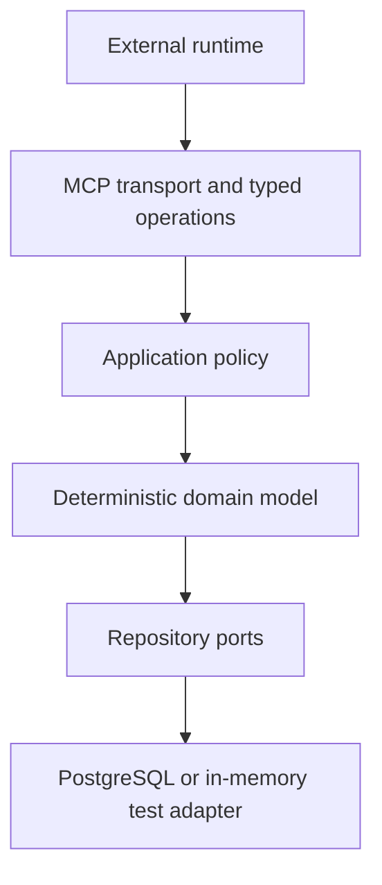

# Architecture Boundary

Status: frozen Phase 1 boundary  
Protocol version: `1`

AI Nature Company is operated by agents, but intelligence does not live in the MCP server. External runtimes create and invoke agents. The substrate gives those agents a deterministic, shared operating protocol.

## The boundary

| External agent runtime owns | MCP substrate owns |
|---|---|
| Model and provider selection | Verified principal identity |
| Inference and context assembly | Company-scoped role grants |
| Agent instantiation and scheduling | Versioned agent definitions and bindings |
| Retry policy for model invocations | Durable work, leases, and run receipts |
| Interpretation, planning, and creative work | Policy and state-transition enforcement |
| Hypotheses and strategy proposals | Revision checks and idempotent mutations |
| Selection of permitted MCP operations | Budgets, reservations, and actual costs |
| Application of retrieved learning | Evidence provenance and immutable lineage |
| Human interaction in the host | Evaluation independence and allocation gates |
| | Append-only domain and audit events |

The server can compute a documented deterministic score, validate a typed contract, and invoke an explicitly approved non-generative adapter. It cannot decide what to think about next or silently ask a model to do so.

## Forbidden inside the substrate

- Model inference, model routing, prompt execution, or an autonomous agent scheduler.
  A process-owned tick that only applies frozen stop rules and lease expiry is in
  bounds; a planner or model runtime inside the server is not.
- Model-provider credentials, BYOK fields, or a fallback inference endpoint.
- Hidden chain-of-thought, private scratchpads, or agent debate transcripts.
- Caller-supplied identity, company, role, budget, or entitlement used as authority.
- Semantic ranking or embedding fallback whose inputs and algorithm are not part of the versioned protocol.
- Unrecorded external side effects, unsupported success claims, or silent state mutation.
- An executing principal serving as the sole evaluator of the same experiment.
- Constitution mutation or an irreversible action without founder authority.

## Dependency direction

The domain model has no dependency on MCP, an agent framework, a model SDK, or PostgreSQL. Transport derives a trusted call context from authentication and passes it inward. Repositories persist decisions already authorized by the application layer.

No package whose purpose is model inference is permitted in the server dependency graph. A repository test scans source and declared dependencies for known model-provider imports and credential paths. This is a guardrail, not proof by itself; review remains required.

## Verified call context

Every request enters the application layer with server-derived context containing:

- principal ID;
- company membership;
- concrete instance, active agent-definition ID/version, fixed role, and optional
  cell binding, when the caller is an agent;
- active agent-run ID, when the request belongs to a run;
- server-owned role grants and their resource scopes;
- server-generated transport request and trace identifiers.

Payload fields that repeat any of those values are never authority. They are ignored
for authorization or rejected when an operation contract treats them as an explicit
assertion; they cannot replace the server-resolved identity. Call attribution always
records the trusted context, including for an authorized or denied request whose
payload tried to claim another identity.

The Phase 1 identity stub maps test credentials to fixed server-owned principal
records and remains suitable only for local execution. Hosted operation uses strict
Supabase OAuth/JWT verification and resolves the exact external issuer, subject,
OAuth client, protected resource, and live session through a hardened database
function. That resolution returns one active server-owned principal, concrete agent
instance, immutable definition version, role/cell binding, and revocable run. Neither
the bearer token nor MCP payload may choose those application identities.

Agent definitions are reusable reviewed contracts; agent instances are concrete
role/cell identities. Multiple instances may share a definition, while each hosted
`(issuer, subject, client_id)` authentication tuple maps to exactly one active
principal and instance. Every authenticated tool invocation appends a
content-minimized `received` audit event
before dispatch and one terminal `succeeded`, `denied`, or `failed` event. The audit
stores trusted identity and digests, never the bearer token or raw arguments/result.

A hosted agent call also requires the exact immutable definition projection and a
domain instance that matches the verified instance, definition version, role, and
cell. Effective authority is the intersection of that definition's capability
ceiling, stored allowed actions, server-owned role policy, target cell, resource
state, and any required live work lease. Missing or mismatched records fail closed.

A verified human founder may operate without an agent-definition binding when its
company-root founder grant authorizes the operation and the explicit human-founder
binding bypass. A union of roles across narrower or unrelated scopes never creates
that bypass. Human founder decisions record principal and server time; they do not
invent an agent run.

## External actions

The Phase 1 vertical slice uses fake adapters. The durable protocol for a future real adapter is still fixed:

1. Record the requested intent and idempotency key.
2. Verify principal, grant, resource revision, policy, budget, approval, and stop state.
3. Reserve the bounded budget atomically.
4. Invoke the adapter with a stable request identifier.
5. Record the observed result and actual cost.
6. Release unused reservation or record a compensating action.

A timeout is not evidence that an external action failed. Reconciliation must query by the stable adapter request identifier before retrying.

## Persistence and isolation

PostgreSQL is canonical for operational state and append-only events. Git is canonical for reviewed schemas, constitutions, fitness rules, migrations, and promoted knowledge. Git is not the runtime event queue.

Every operational row is company-scoped. Production database roles must use row-level security and must not have `BYPASSRLS`. Company predicates are defense in depth; application authorization remains mandatory.

CI applies the reviewed migration as the database owner, then runs the application repository contract through a temporary `NOSUPERUSER`/`NOBYPASSRLS` role. The integration test proves both cross-company reads and writes fail closed; unit coverage does not substitute for that live PostgreSQL check.

## Failure posture

- Unknown identity, missing grants, stale revisions, expired leases, exhausted budgets, and unknown operations fail closed.
- A policy or stop-rule violation prevents new side effects in the affected scope.
- Reads needed for audit, evaluation, reconciliation, and cleanup remain available while paused.
- Evidence is corrected by a linked event, never edited in place.
- Irreversible history is preserved even when a cell, experiment, or agent is killed or revoked.
