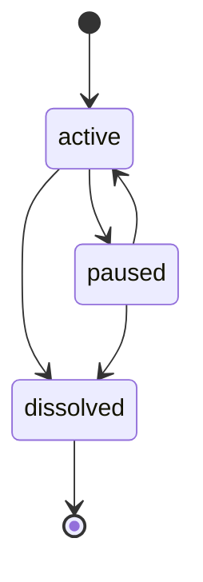
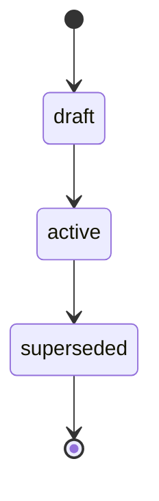
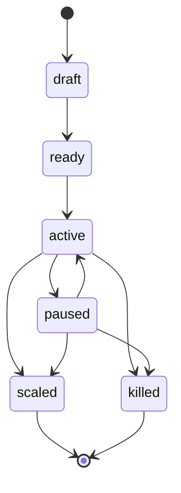
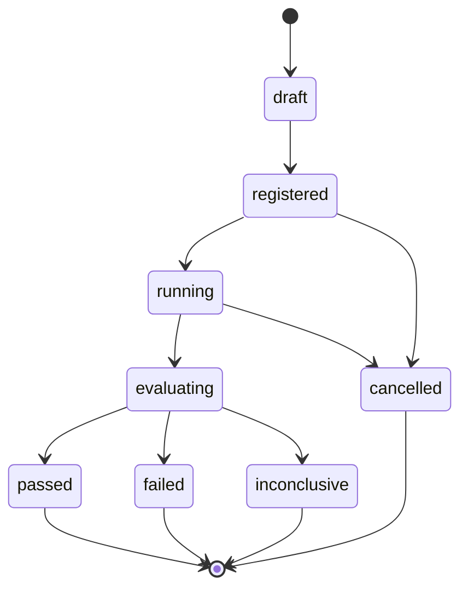
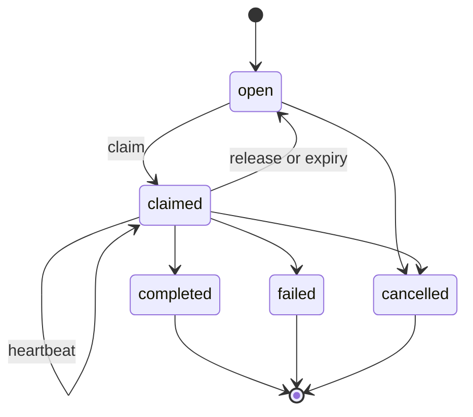
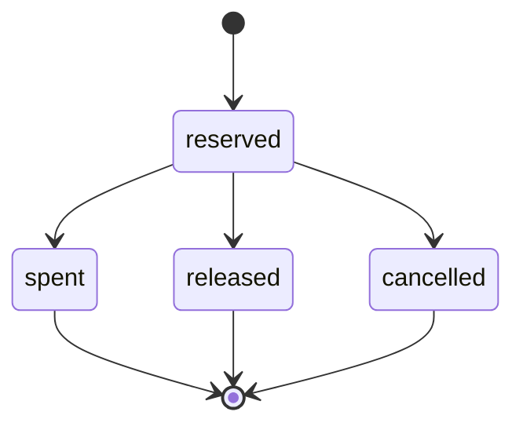
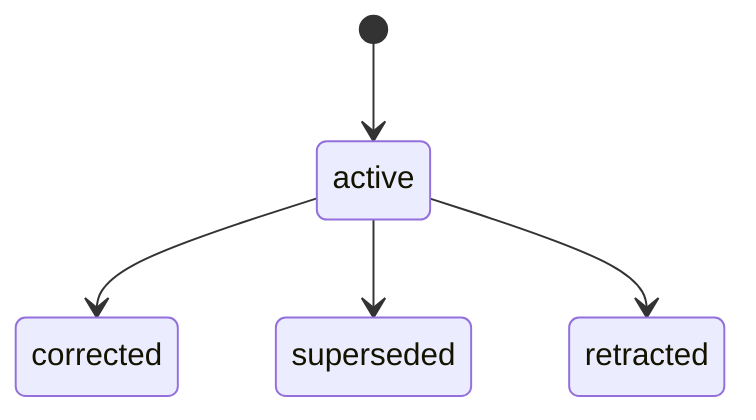
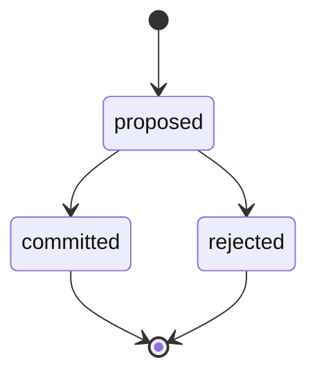
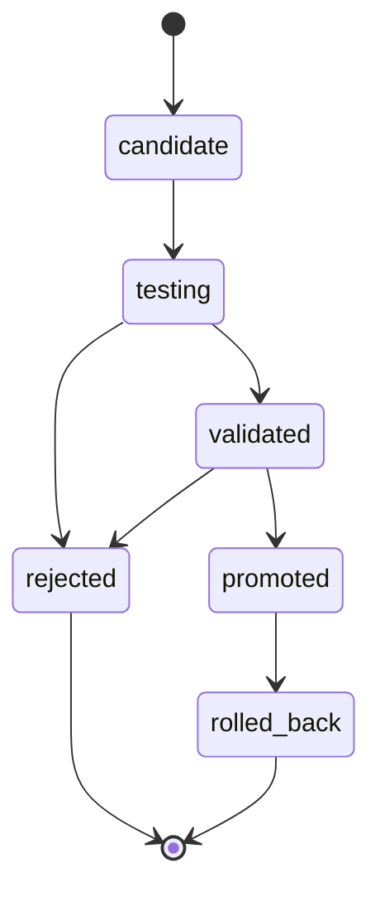

# Phase 1 State Machines

Status: normative v1 transition contract

All state changes are compare-and-set operations using the current aggregate revision. A permitted edge is necessary but not sufficient: identity, grant, enclosing-resource state, budget, approvals, and policy must also pass.

## Company

Founder-derived authority is mandatory for `dissolved`; caller payloads cannot supply that authority. Pausing blocks new external side effects while retaining the audit, evaluation, reconciliation, and cleanup reads needed for safe operation. `dissolved` is terminal.

## Constitution

Activation and supersession require founder-derived authority and exact version comparison. At most one constitution version may be active for a company. Supersession records the replacement constitution ID; historical events and decisions retain the constitution ID and version that governed them.

## Offer cell

| From | To | Required conditions |
|---|---|---|
| `draft` | `ready` | Complete immutable offer, accountable owner, cell budget, and eligible customer boundary. |
| `ready` | `active` | Registered experiment or approved operating mandate; no blocking incident. |
| `active` | `paused` | Cell-owner, deferred immune, or founder pause authority; a committed `cell_owner_authorized` or `founder_authorized` containment decision; or an automatic policy/stop-rule trigger. |
| `paused` | `active` | Trigger remediated, cell-owner operational authority, required approval recorded, and budget remains valid. |
| `active` | `scaled` | Current repeatability, customer outcome, evidence, and contribution-profit gates pass, with founder-only irreversible transition authority. |
| `paused` | `scaled` | Same gates as above plus explicit remediation/unpause approval and founder-only irreversible transition authority. |
| `active` | `killed` | Founder-signed irreversible containment, or owner-signed with a required `founder_decision_ref` when no experiments are open and no work is open or claimed; immune authority is limited to pause. |
| `paused` | `killed` | Founder-signed irreversible containment, or owner-signed with a required `founder_decision_ref` when no experiments are open and no work is open or claimed; immune authority is limited to pause. |

The `paused` to `active` edge is a forward contract. Phase 1 rejects it for every
role until remediation, approval, and budget validity can be atomically bound to the
transition.

The two `scaled` edges are a forward contract. Phase 1 rejects them for every role,
including founder, until the state transition and the exact cell revision can be
atomically bound to a verified, current fitness-gate decision.

`killed` and `scaled` are terminal under the v1 state machine. A later attempt is a
new clone/child cell with lineage rather than a resurrection or silent downgrade.
`paused` blocks new side effects and work claims but permits reads, evidence
correction, evaluation, reconciliation, and cleanup.

Owner-signed `cell.amend` may revise an active cell's objective text when a
`founder_decision_ref` is recorded; prior objective stays in amendment history.
It must not change budget, stage, owner, authority, or constitution, and it
must not amend a terminal cell.

## Offer version

An offer version has no lifecycle transition. `offer.register` creates an immutable version-1 root with a null parent. `offer.mutate` creates a new version-2-or-later child that names its parent and carries a non-empty mutation summary. Identity and lineage fields cannot be changed in place; a correction is another child version.

## Experiment

| From | To | Required conditions |
|---|---|---|
| `draft` | `registered` | Complete v1 protocol; material fields are frozen at the new revision. |
| `registered` | `running` | Active cell, authority, approvals, window, policy, and atomic budget reservation. |
| `registered` | `cancelled` | Authorized cancellation; no spend reservation is consumed. |
| `running` | `evaluating` | Intake closed, actual cost recorded, unused reservation releasable, frozen evaluation snapshot created. Optional `reason` and `founder_decision_ref` on `experiment.close` persist on the experiment and audit trail. |
| `running` | `cancelled` | Stop rule, policy block, founder action, or unrecoverable execution failure; preserve partial evidence. |
| `evaluating` | `passed` | Independent evaluation meets all preregistered success criteria. Passed criteria require cited evidence. |
| `evaluating` | `failed` | Independent evaluation meets a failure criterion or fails required success criteria under the frozen rule. A count criterion observed 0 with no qualifying fitness evidence may fail with empty `evidence_ids`. |
| `evaluating` | `inconclusive` | Data sufficiency or attribution is inadequate and no failure rule mandates `failed`. |

Terminal states are `passed`, `failed`, `inconclusive`, and `cancelled`. Late authoritative events append after close only when their `observed_at` lies in the frozen window and the source proves delayed delivery. They do not rewrite the terminal evaluation; reevaluation creates another versioned evaluation under explicit authority.

Material changes to population, metrics, thresholds, actions, executors, evaluator, offer version, or budget unit after registration require a new experiment ID with lineage. Owner-signed `experiment.amend` may extend a running experiment's window end, revise stop-rule, treatment, or hypothesis window text, change try-budget amount through the reservation ledger, or set an experiment `max_external_messages` override when a `founder_decision_ref` is recorded; prior values stay in amendment history. It must not retrofit success or failure criteria or amend the constitution. Defend and the tick judge the clock against `window_ends_at`, not dates in hypothesis prose.

## Work item and lease

| Transition | Deterministic rule |
|---|---|
| `open -> claimed` | One eligible principal atomically receives one opaque lease until server expiry. |
| `claimed -> claimed` | Heartbeat by the same principal/run and valid token extends expiry within the policy cap. |
| `claimed -> completed` | Same principal/run, live lease, valid output contract, recorded actual cost. |
| `claimed -> failed` | Same principal/run records typed failure after attempts are exhausted or failure is terminal. |
| `claimed -> open` | Voluntary release, retryable failure, or server-observed expiry while attempts remain; old token is revoked. |
| `open/claimed -> cancelled` | Authorized cancellation; a live lease is revoked and later completion fails. Owner-signed MCP `work.cancel` is narrower: own cell only, never-claimed, no active lease, required `reason` preserved in `cancellation_history`. |

Claim increments the attempt count exactly once. Heartbeat and idempotent replay do not. When expiry consumes the final permitted attempt, projection moves to `failed`. A completion received after expiry fails even if the work has not yet been reclaimed.

## Budget reservation

Reservation, spend, release, and cancellation update the reservation and its budget totals atomically. Amounts are exact non-negative integers in one unit of account: ISO 4217 minor units for money, whole seconds for time, or whole counts for cycles and tries. A reservation cannot consume a ledger in a different unit. A new reservation requires an active in-window budget and cannot exceed `limit - spent - reserved`; replay never reserves or spends twice. A budget becomes `exhausted` when spent plus still-reserved funds reaches its limit and may return to `active` only when a reservation is released or cancelled. A `closed` budget accepts no new reservation or spend; release and cancellation remain available for cleanup under policy.

## Evidence projection

Evidence is an event lineage, not an editable row:

- An original event has no related evidence ID.
- A correction points to one active event and supplies the corrected observation.
- A supersession points to one active event and replaces its relevance with a new observation.
- A retraction points to one active event and removes it from current scoring without deleting it.
- A cycle, self-reference, cross-company link, or second active correction of the same revision fails.

The projection exposes current status and the full lineage. Allocation input snapshots identify the exact evidence IDs used, so later correction does not rewrite an earlier decision.

## Evaluation

An evaluation is append-only and has one terminal result: `passed`, `failed`, or `inconclusive`. It is accepted only while the experiment is `evaluating`, against the exact frozen experiment revision, and from a verified evaluator principal that is absent from the experiment's executor set.

A rejected evaluation does not change experiment state. An accepted evaluation and the matching experiment terminal transition commit atomically.

## Allocation

- A proposal freezes target revision, constitution/rule version, gate results, ranking inputs, score fraction, amount, and proposer attribution.
- Commit rechecks all mutable preconditions. It does not trust the proposal's earlier pass result.
- A stale target, constitution change, new policy block, or unavailable budget rejects the commit without partial reservation.
- Non-funding actions carry a null amount and reserve no budget. Containment carries
  a recorded `founder_authorized` or `cell_owner_authorized` basis in the decision
  projection and linked events, retains truthful gate results, and uses the exact
  unranked score `0/1`.
- Containment `pause` is committed by the bound cell owner or a deferred allocator;
  `kill` requires founder-only irreversible authority. The allocation, decision, and
  exact target cell transition commit atomically, and replay does not transition the
  cell twice.
- `committed` and `rejected` are terminal. Changing any decision input creates a new proposal.

## Governed learning (reserved for Phase 4)

The lifecycle below is the forward contract for governed reusable learning. `learning.propose` now persists a `candidate` from cited experiment, evaluation, and evidence. `learning.promote` still fails closed until evidence transfer tests, approvals, and rollback projection land together. The proposing principal cannot promote.

| From | To | Required conditions |
|---|---|---|
| `candidate` | `testing` | Source experiment, evaluation, evidence, applicable context, proposed test, and rollback condition are present. |
| `testing` | `validated` | Independent test demonstrates the preregistered transfer effect in the applicable context. |
| `testing` | `rejected` | Test falsifies transfer or required evidence cannot be obtained within its bound. |
| `validated` | `promoted` | Required approval records the immutable skill/policy version and activation scope. |
| `validated` | `rejected` | Validation is superseded by contradictory evidence before promotion. |
| `promoted` | `rolled_back` | Recorded rollback condition fires; new use stops while historical attribution remains. |

`rejected` and `rolled_back` are terminal. A revised candidate receives a new ID with lineage. The producer cannot be the only validator, and one successful source run cannot move a candidate directly to `promoted`.

## Idempotency and event atomicity

For every mutation, the aggregate update, budget movement, domain events, audit event, and idempotency response commit in one transaction. Outcomes are:

| Situation | Result |
|---|---|
| New key, current revision, valid transition | Commit once and cache exact response. |
| Same key and same request digest | Return cached response with `replayed: true`. |
| Same key and different digest | `conflict` (idempotency digest mismatch); no mutation. |
| New key and stale revision | `conflict` (stale aggregate revision); no mutation. |
| Concurrent valid writers | At most one wins the revision compare-and-set. |

The event stream records `aggregate_type`, `aggregate_id`, `aggregate_revision`, event type/version, server timestamp, verified principal, agent definition/version, agent run, correlation ID, and bounded payload. Projection rebuild processes events in aggregate revision order and fails on a gap or duplicate revision.
